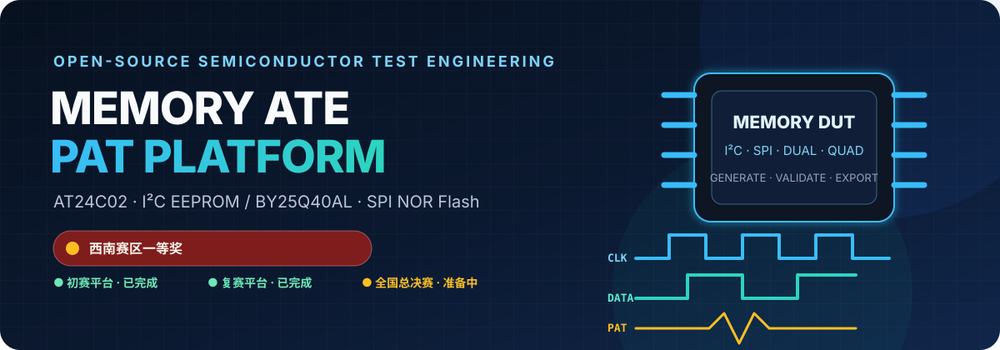
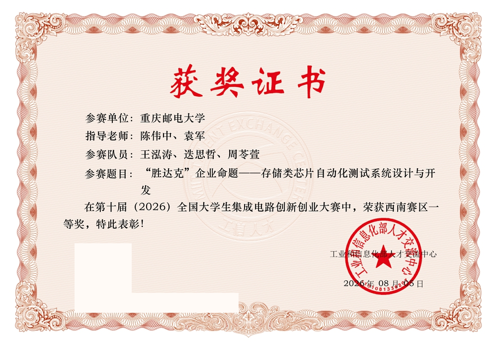
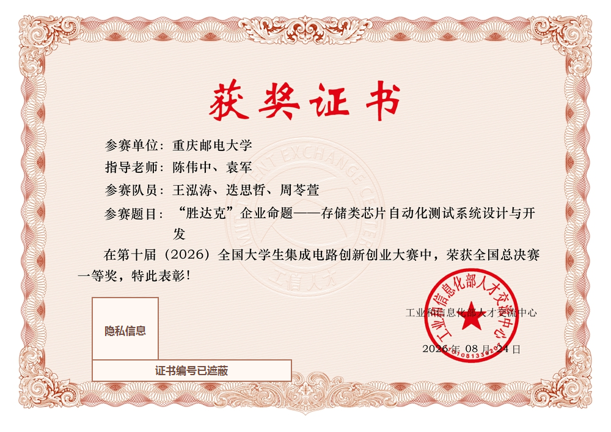
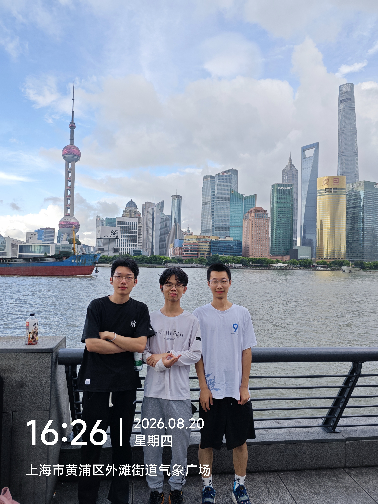
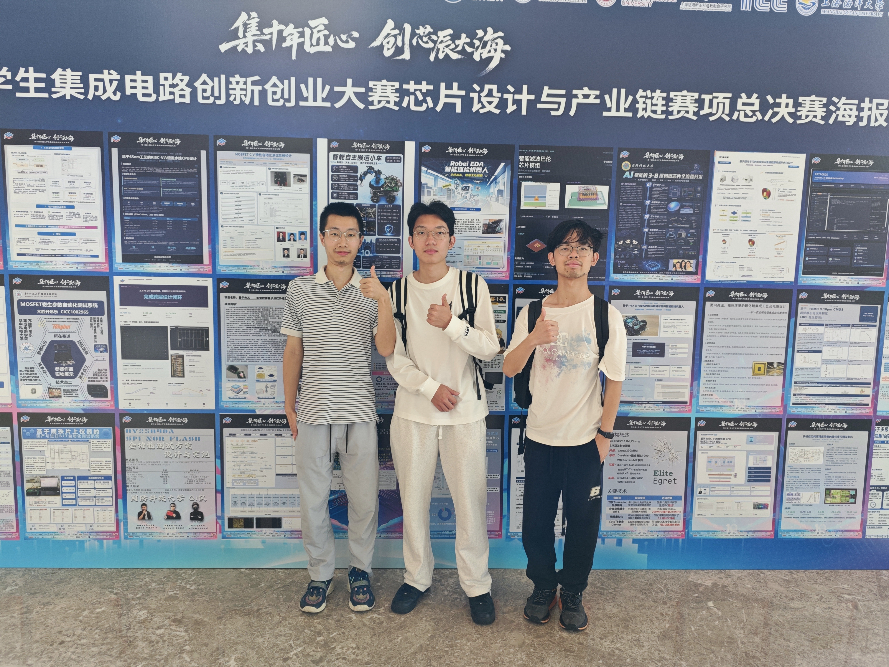
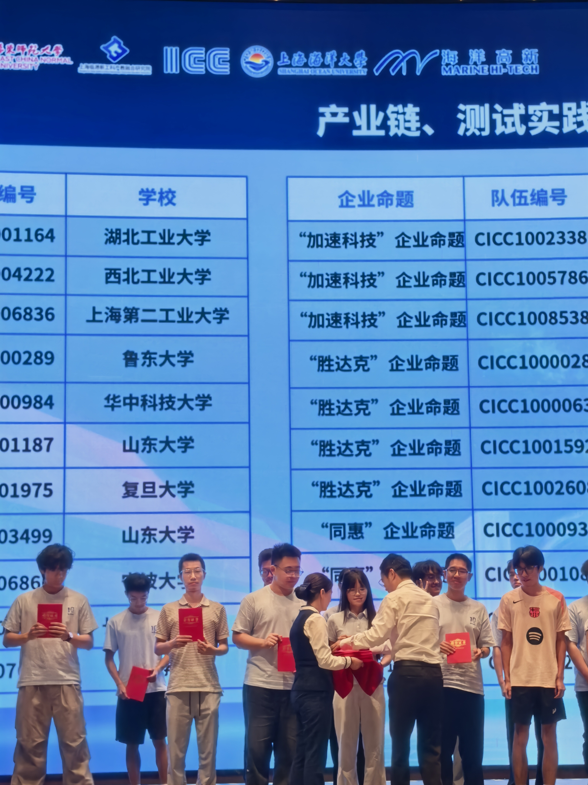
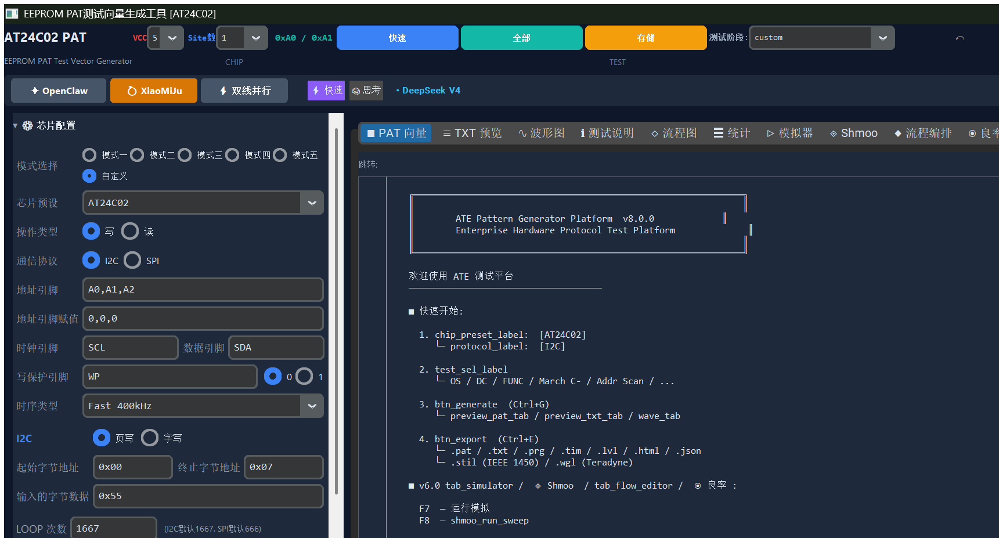
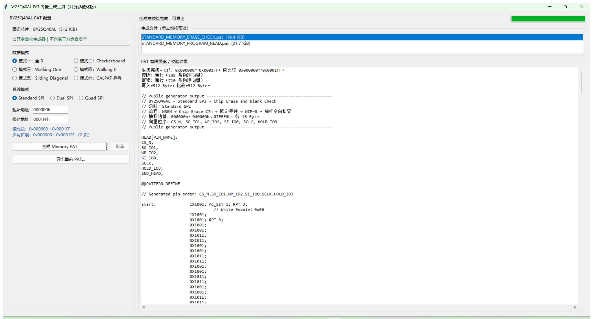
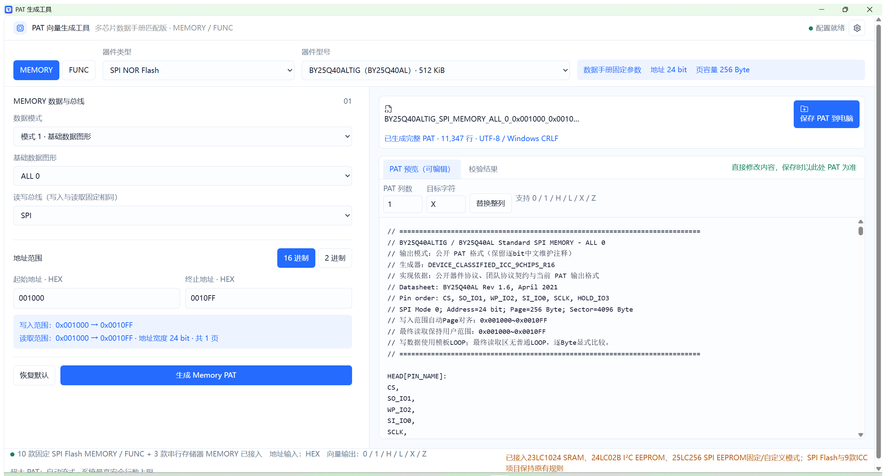

# Memory ATE PAT Platform

[简体中文](README.md) · English

> Open-source memory-device ATE test and PAT generation software<br>
> Built for the “ShengDaKe” enterprise challenge of the National College Student Integrated Circuit Innovation and Entrepreneurship Competition

[](https://www.python.org/)
[](https://github.com/Xiaomiju-x/memory-ate-pat-platform/actions/workflows/ci.yml)
[](docs/competition.md)
[](docs/competition.md)
[](https://github.com/Xiaomiju-x/memory-ate-pat-platform/releases/tag/national-final-v1.0.9)



Memory ATE PAT Platform is an engineering project for generating, inspecting, and analyzing memory-device test patterns. It contains three deliberately separate implementations:

- **Preliminary round — AT24C02 platform:** an end-to-end desktop and CLI platform covering protocol-level vectors, test plans, ATE project files, waveform/flow visualization, simulation, coverage, yield, and datalog analysis.
- **Southwest regional round — BY25Q40AL platform:** a competition-tuned GUI/CLI generator for Standard, Dual, and Quad SPI, six memory-test modes, address-range handling, PAT validation, and reproducible public tests.
- **National finals — multi-device PAT platform:** an offline Electron application for SPI Flash, SRAM, I²C EEPROM, and SPI EEPROM, with MEMORY/FUNC workflows, SPI/SDI/SQI modes, large-pattern streaming, and a Windows x64 portable release. Version 1.0.9 is open source.

The national finals have concluded, and the team received **First Prize in the National Finals**. “First Prize” is an award tier, not an overall ranking.

The team received **First Prize in the Southwest regional stage** and **First Prize in the National Finals**. These are team awards. The repository maintainer’s primary responsibilities are code and algorithms, construction of the preliminary-round platform, and PAT software development for the regional and national-final stages. Both certificates are published with permission; their QR codes and certificate numbers are redacted while the award information and credited participants remain visible.

| Southwest regional First Prize | National Finals First Prize |
|---|---|
|  |  |

> Published to document the team awards. The [official award listing](https://univ.ciciec.com/nd.jsp?fromMid=3&groupId=2&id=1083) provides an additional public competition record. Names, seals, and competition marks remain with their respective rights holders; displaying the certificates does not imply endorsement of this repository.

### National Finals First Prize and team memories

The following documentary photographs record the team’s national-finals trip to Shanghai, the project poster session, and the First Prize ceremony. Team members have consented to publication of their real likenesses. Hidden EXIF/GPS metadata has been removed, and unrelated attendees are not identified.

| Shanghai team memory | National-finals poster session | First Prize ceremony |
|---|---|---|
|  |  |  |

> These photographs document the team’s participation and award. Team likenesses are published with consent. Event graphics, posters, marks, and venue materials remain with their respective rights holders; display does not imply endorsement of this repository.

The official context is available from the [10th competition rules](https://univ.ciciec.com/col.jsp?id=123), the [official ShengDaKe challenge page](https://univ.ciciec.com/nd.jsp?id=1024), and the [official award listing](https://univ.ciciec.com/nd.jsp?fromMid=3&groupId=2&id=1083). The detailed project story is documented in [`docs/competition.md`](docs/competition.md).

## Open-source scope

This repository publishes only code, algorithms, tests, documentation, and generated examples independently created by the team.

It does **not** distribute organizer-provided golden PAT files, vendor FUNC reference templates, training material, private specifications, tools, or other restricted competition resources. Access granted during a competition does not imply redistribution permission. The internal regional-round build was exercised with 30 regression tests in an authorized environment; public CI uses team-authored generalized tests and generated fixtures, and must not be presented as byte-for-byte certification against private reference material.

Lawful holders may perform their own offline checks only within the scope of their authorization. This project does not accept, locate, automatically read, or provide restricted assets, and it provides no asset hashes, copying utilities, or private-reference comparison tools. Private validation is not part of the public reproduction procedure. See [`docs/legal-and-ip.md`](docs/legal-and-ip.md).

## Software screenshots

These are real captures of the current public builds, not mockups. The regional and national-finals views show PAT output produced by the applications.

### Preliminary round — AT24C02 platform



### Regional round — BY25Q40AL platform



### National finals — multi-device PAT platform



## Highlights

### AT24C02 and general platform

- I2C, SPI, and Microwire vector generators with multiple built-in memory-device profiles;
- OS, DC, functional read/write, March C-, March B, address scan, retention, error/boundary, endurance, and IDDQ logic;
- I2C START/STOP, repeated START, byte/page writes, random/sequential reads, ACK/NACK, ACK polling, WP, and address-boundary handling;
- PAT, TXT, PRG, TIM, LVL, HTML, JSON, CSV, DLOG, STIL, and WGL export paths;
- timing/protocol/file validation, reverse parsing, simulation, ATPG/fault coverage, Shmoo, yield, guard-band, correlation, wafer-map, and STDF utilities;
- GUI and headless batch modes, voltage presets, multi-site configuration, test phases, and Chinese/English UI.
- optional AI diagnostics that contact `api.deepseek.com` only after the user explicitly configures `DEEPSEEK_API_KEY` and invokes the feature; no key is needed otherwise, and restricted PAT assets or personal data must not be entered.

### BY25Q40AL regional-round platform

- Standard, Dual, and Quad SPI;
- all-zero, checkerboard, walking-one, walking-zero, sliding-diagonal, and GALPAT modes;
- 24-bit address validation, 256-byte page alignment for programming, and exact user ranges for read comparison;
- a team-authored parameterized generator, PAT syntax/transaction validation, GUI, CLI, and public generalized regression tests;
- a standalone Windows build path without bundling third-party competition assets.

### National-finals PAT platform

- an offline Electron desktop application for Windows 10/11 x64, requiring no Python or Node.js at runtime;
- fixed and custom SPI Flash plus 23LC1024 SRAM, 24LC02B I²C EEPROM, and 25LC256 SPI EEPROM;
- MEMORY/FUNC views, SPI/SDI/SQI, data modes, address ranges, and configurable transactions;
- editable normal-size previews, six-column replacement, validation, and native file saving;
- cooperative generation, cancellation, disk-backed streaming, and a bounded 5,000-line preview for very large PAT files;
- sandboxed Electron renderer, context isolation, allow-listed IPC, offline CSP, and network blocking;
- locked dependencies, 19 public Node unit/integrity tests, 31 Electron interaction/generation checks, reproducible build scripts, and bundled third-party notices.

See [`national-final/`](national-final/README.md) for source and build instructions, or download the Windows portable executable from the [`national-final-v1.0.9` release](https://github.com/Xiaomiju-x/memory-ate-pat-platform/releases/tag/national-final-v1.0.9). The software still requires target-ATE, device, and authorized-format validation; publication is not organizer certification or an award claim.

## Quick start

The primary development platform is Windows 10/11 with Python 3.10 or newer. The main GUI requires `customtkinter`; the regional tool uses the Python standard library and `tkinter` at runtime.

```powershell
git clone https://github.com/Xiaomiju-x/memory-ate-pat-platform.git
cd memory-ate-pat-platform

py -3.10 -m venv .venv
.venv\Scripts\Activate.ps1
python -m pip install --upgrade pip
python -m pip install -r requirements.txt
```

Launch the general GUI:

```powershell
python at24c02_pat_generator.py
```

Generate an AT24C02 package without a GUI:

```powershell
python at24c02_pat_generator.py `
  --batch --chip AT24C02 --protocol I2C `
  --tests all --format all --output output_cli
```

Launch the regional-round GUI:

```powershell
python "regional-final\by25q40al\by25q40al_pat_generator.py"
```

Generate a Standard-SPI checkerboard pattern:

```powershell
python "regional-final\by25q40al\by25q40al_pat_generator.py" `
  --batch --mode mode_2 --bus SPI `
  --start 000000h --end 0001FFh --output regional_output
```

Run the public tests:

```powershell
python -m unittest discover -s tests -v

Push-Location "regional-final\by25q40al"
python -m unittest discover -s tests -v
Pop-Location
```

Run the national-finals platform from source with Node.js 22.12.0:

```powershell
Push-Location national-final
npm ci
npm test
npm run start
Pop-Location
```

Users who do not need a development environment can download the Windows x64 portable build from the [release page](https://github.com/Xiaomiju-x/memory-ate-pat-platform/releases/tag/national-final-v1.0.9) and verify its SHA-256 there.

See the full [`quickstart`](docs/quickstart.md) for configuration, validation, and Windows packaging.

## Output formats

| Format | Role |
|---|---|
| `.pat` | Executable cycle-by-cycle digital patterns |
| `.txt` | Human-readable vector preview |
| `.prg` | EStar-style schedule and test-plan template |
| `.tim` | Timing-set definitions |
| `.lvl` | Power and digital-level definitions |
| `.stil`, `.wgl` | Interchange/export formats |
| `.html`, `.svg` | Reports, waveforms, flows, and plots |
| `.json` | Reproducible configuration snapshots |
| `.csv`, `.dlog`, `.stdf` | Statistics and test-data exchange |

PAT files from the three platforms are not interchangeable merely because they share an extension. Pin ordering, vector symbols, clock phases, compare timing, labels, and file-level conventions must be interpreted together. See [`docs/formats.md`](docs/formats.md).

## Validation boundaries

Repository tests cover Python importability, file structure, vector semantics, protocol/transaction constraints, edge cases, and generated fixtures. They do not replace:

- verification against the exact datasheet revision for the purchased device;
- target-ATE offline compilation/import;
- pin-map, load-board, relay, level, timing, current-limit, and power-sequence review;
- controlled validation with real silicon;
- production correlation or qualification.

The project is not official software from the competition organizer, ShengDaKe, a device vendor, or AdaptStar-E. It makes no blanket claim of production readiness, universal tester compatibility, or risk-free DUT execution. Simulated yield, Shmoo, wafer-map, and datalog results must be labeled as simulated unless backed by separately imported measurements.

## Documentation

- [`docs/quickstart.md`](docs/quickstart.md) — installation, CLI, testing, and packaging;
- [`docs/architecture.md`](docs/architecture.md) — layers, data flow, and validation levels;
- [`docs/competition.md`](docs/competition.md) — stages, award wording, and responsibilities;
- [`docs/formats.md`](docs/formats.md) — vector states and file-format contracts;
- [`docs/legal-and-ip.md`](docs/legal-and-ip.md) — open-source and restricted-asset boundaries;
- [`docs/roadmap.md`](docs/roadmap.md) — completed work, finals-platform validation, and engineering roadmap;
- [`docs/faq.md`](docs/faq.md) — common technical and project questions;
- [`CHANGELOG.md`](CHANGELOG.md) — public releases, significant changes, and known limitations;
- [`CITATION.cff`](CITATION.cff) — machine-readable software citation metadata.

## Contributing

Issues, tests, protocol corrections, documentation improvements, and properly sourced device profiles are welcome. Read [`CONTRIBUTING.md`](CONTRIBUTING.md), [`SUPPORT.md`](SUPPORT.md), [`SECURITY.md`](SECURITY.md), and [`CODE_OF_CONDUCT.md`](CODE_OF_CONDUCT.md) first.

Never submit secrets, personal information, private tester manuals, organizer/vendor reference assets, or material whose redistribution rights you cannot establish. If this project helps your coursework, competition, or tool development, please star the repository, use [`CITATION.cff`](CITATION.cff) to cite the exact version or commit, and share a reproducible improvement.

The repository license applies only to material the licensors have the right to license. Third-party names, marks, devices, and materials remain the property of their respective owners.
