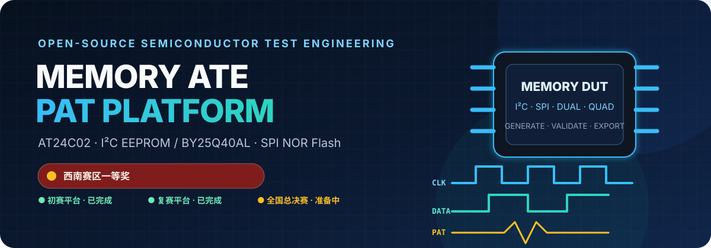
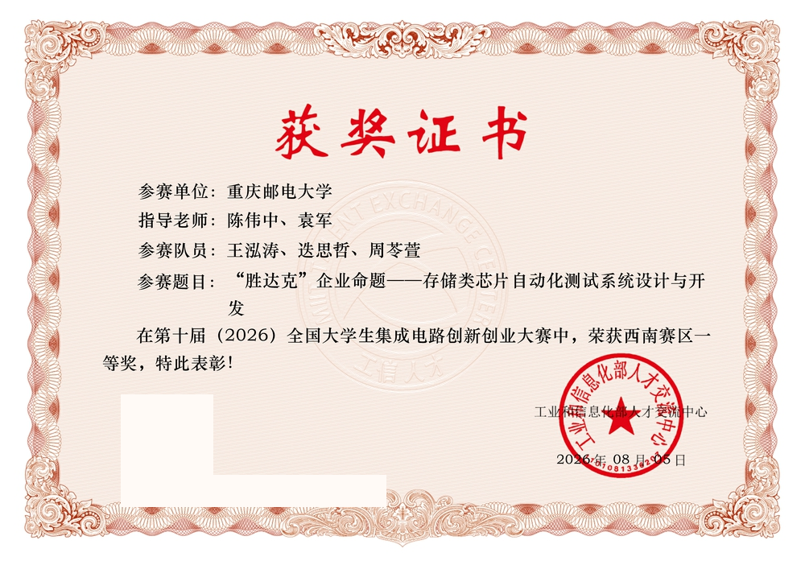

# Memory ATE PAT Platform

[English](README.en.md) · 简体中文

> 存储芯片自动测试与竞赛 PAT 向量平台<br>
> 全国大学生集成电路创新创业大赛「胜达克」企业命题 · 西南赛区一等奖（赛区第一）

[](https://www.python.org/)
[](#快速开始)
[](https://github.com/Xiaomiju-x/memory-ate-pat-platform/actions/workflows/ci.yml)
[](docs/competition.md)
[](docs/roadmap.md)



这是一个围绕存储芯片 ATE（Automatic Test Equipment）测试开发的开源项目。仓库包含两条彼此关联、但定位不同的技术路线：

- **初赛：AT24C02 完整测试平台**——从协议向量、测试方案、格式导出，到波形、流程、仿真、良率与测试数据分析的桌面工具；
- **复赛：BY25Q40AL 竞赛优化 PAT 平台**——围绕 Standard/Dual/Quad SPI、六类 Memory 数据模式、参数化生成和格式验证构建的专用生成器；
- **决赛：准备中**——决赛 PAT 向量生成测试软件仍在开发，本仓库只预留公开位置，不把计划中的能力描述为已完成。

项目获得全国大学生集成电路创新创业大赛「胜达克」企业命题**西南赛区一等奖，并位列赛区第一**。奖项属于参赛团队；仓库维护者主要负责代码与算法、初赛平台搭建，以及复赛和决赛阶段面向竞赛约束的 PAT 软件开发。

奖项证书已获授权公开；展示版本遮蔽了二维码与证书编号，保留参赛单位、指导教师、参赛队员、赛题和奖项信息。



> 证书用于记录参赛团队获得西南赛区一等奖；“赛区第一”同时以[大赛官网获奖名单](https://univ.ciciec.com/nd.jsp?fromMid=3&groupId=2&id=1083)为依据。赛事名称、印章和相关标识归各自权利人所有，展示不表示主办方或命题企业为本开源仓库背书。

> **English summary:** An open-source memory-device ATE/PAT generation project developed for the “ShengDaKe” enterprise challenge of the National College Student Integrated Circuit Innovation and Entrepreneurship Competition. It contains the completed AT24C02 preliminary-round platform and the competition-tuned BY25Q40AL regional-round generator. The national-finals software is still in preparation and is intentionally not presented as complete. Documentation is Chinese-first; commands, file formats, architecture diagrams, and code identifiers are English-friendly.

## 目录

- [项目为什么开源](#项目为什么开源)
- [竞赛阶段与仓库内容](#竞赛阶段与仓库内容)
- [核心能力](#核心能力)
- [快速开始](#快速开始)
- [输出文件](#输出文件)
- [项目结构](#项目结构)
- [技术边界](#技术边界)
- [文档导航](#文档导航)
- [贡献与引用](#贡献与引用)

## 项目为什么开源

PAT 工具常常同时涉及器件协议、存储器测试算法、ATE 向量语义、设备私有方言和工程交付格式。公开这个项目，不只是提供一个可执行文件，也希望保留一条可复查的工程路径：

1. 从器件地址、时序和测试目标出发生成逐周期向量；
2. 将功能测试、March 算法、异常事务等组合成可解释的测试段；
3. 在导出前执行语法、协议、事务和自生成样例回归；
4. 同时输出机器文件、人类可读预览和分析报告；
5. 明确区分通用平台能力、竞赛专用适配和仍需真机确认的边界。

适合读者包括集成电路测试方向学生、ATE/PAT 工具开发者、存储器测试算法学习者，以及希望了解竞赛软件如何从原型演进到可回归交付的人。

### 开源范围与合规边界

本仓库只开源团队独立创作的代码、算法、公开测试和自生成样例。根据[第十届大赛章程](https://univ.ciciec.com/col.jsp?id=123)，团队对独立创作作品享有知识产权，但企业在赛题中提供的已有方案、参考案例、数据库、素材或其他背景资料不属于团队作品，赛事资源和相关技术内容未经授权不得传播。因此本仓库**不包含、也不会代为提供**：

- 赛方原始黄金 PAT 或由其逐字节复制的文件；
- 企业提供的 FUNC 参考模板、培训材料、私有规范或工具；
- 能够规避授权、复原或重新分发上述材料的下载方式。

复赛现场内部版本曾在获授权环境中运行 30 项回归；公开版改用团队自生成样例和泛化测试，不能把公开 CI 等同于第三方参考语料的逐字节认证。合法持有相关资料者只能在授权范围内自行离线核验；本项目不接收、不定位、不自动读取或提供相关资产，也不提供其哈希、复制或对比工具。私有核验不属于公开复现步骤。完整原则见[知识产权与公开边界](docs/legal-and-ip.md)。

## 竞赛阶段与仓库内容

| 阶段 | 器件 / 目标 | 公开实现 | 当前状态 |
|---|---|---|---|
| 初赛 | AT24C02 I2C EEPROM 完整自动测试平台 | 根目录主程序、批量生成脚本、示例输出与分析工具 | 已完成，持续整理 |
| 复赛（西南赛区阶段） | BY25Q40AL SPI Flash，针对竞赛约束优化 | 独立 GUI/CLI、六种 Memory 模式、格式/事务验证与公开泛化测试 | 已完成；第三方参考资产不公开 |
| 全国总决赛 | 面向决赛要求的 PAT 向量生成测试软件 | 预留文档与后续目录 | **准备中，尚未发布完成声明** |

阶段背景、奖项口径和个人分工见[竞赛历程](docs/competition.md)。

## 核心能力

### AT24C02 / 通用测试平台

- **协议与器件建模**：I2C、SPI、Microwire；内置 AT24C 系列、兼容 I2C EEPROM、SPI EEPROM / NOR Flash 和 93C 系列预设。
- **测试向量生成**：OS、DC、功能读写、March C-、March B、地址扫描、数据保持、协议异常/边界、耐久性，以及独立 IDDQ 生成逻辑。
- **I2C 事务覆盖**：START / STOP / Repeated START、字节写、随机读、页写、顺序读、主从 ACK/NACK、ACK Polling、WP 和地址边界。
- **ATE 工程导出**：PAT、TXT、PRG、TIM、LVL、HTML、JSON、CSV、DLOG，并可选择导出 STIL 与 WGL。
- **验证与分析**：时序检查、协议验证、PAT 反向解析、EStar 文件检查、向量模拟、故障覆盖率、Shmoo、良率、Guard Band、参数相关性、Wafer Map、STDF 读写等。
- **工程化使用**：GUI 与无界面批处理、多电压预设、多 Site 配置、测试阶段管理、中英文界面、项目和版本对比。
- **可选 AI 诊断**：仅在用户主动配置 `DEEPSEEK_API_KEY` 并调用相关面板时，向 `api.deepseek.com` 发送对话上下文；不使用该功能无需密钥。请勿输入 PAT 私有资产、账号或个人信息。

主程序目前采用单文件集成架构，便于竞赛现场携带和打包；模块边界、数据流与后续拆分方向见[架构说明](docs/architecture.md)。

### BY25Q40AL 复赛专用平台

- Standard SPI、Dual SPI、Quad SPI 三种总线模式；
- 全 0、Checkerboard、Walking One、Walking 0、Sliding Diagonal、GALPAT 六种 Memory 模式；
- 自定义读比较范围与自动页边界扩展；
- Memory PAT 四向量时钟方言、固定 HEAD 引脚顺序和 `0/1/H/L/X` 状态约束；
- 团队独立实现的参数化生成器与专用 PAT 校验器；
- GUI、CLI、公开泛化测试和测试先行的 Windows 打包流程；
- 第三方资产不随仓库分发，也不是公开生成、测试或构建流程的输入。

复赛工具不是通用平台的“皮肤”，而是一套以竞赛方言一致性和可回归交付为优先级的独立实现。详细操作见[复赛软件使用说明](regional-final/by25q40al/README.md)。

## 快速开始

### 环境

- Python 3.10 或更高版本；
- Windows 10 / 11（主要开发与打包平台）；
- 主平台 GUI 依赖 `customtkinter`；Python 自带的 `tkinter` 需要在本机 Python 安装中可用。

```powershell
git clone https://github.com/Xiaomiju-x/memory-ate-pat-platform.git
cd memory-ate-pat-platform

py -3.10 -m venv .venv
.venv\Scripts\Activate.ps1
python -m pip install --upgrade pip
python -m pip install -r requirements.txt
```

启动初赛 / 通用平台 GUI：

```powershell
python at24c02_pat_generator.py
```

无 GUI 生成 AT24C02 工程文件：

```powershell
python at24c02_pat_generator.py --batch --chip AT24C02 --output output_cli --format all
```

生成仓库中的 AT24C02 示例包：

```powershell
python generate_samples.py
```

启动复赛 BY25Q40AL 专用 GUI：

```powershell
python "regional-final\by25q40al\by25q40al_pat_generator.py"
```

复赛 CLI 示例：

```powershell
python "regional-final\by25q40al\by25q40al_pat_generator.py" `
  --batch --mode mode_2 --bus SPI --start 000000h --end 0001FFh `
  --output semifinal_output
```

完整的安装、CLI、测试与打包说明见[快速开始](docs/quickstart.md)。

## 输出文件

| 扩展名 | 用途 | 备注 |
|---|---|---|
| `.pat` | 逐周期数字测试向量 | 合并文件与按测试段拆分文件 |
| `.txt` | 人类可读的向量预览 | 用于评审、排查和展示 |
| `.prg` | 测试流程 / 调度模板 | EStar 风格模板，需结合目标设备确认 |
| `.tim` | 数字通道时序集合 | 驱动沿、比较沿与周期参数 |
| `.lvl` | 电源与数字电平集合 | 多电压预设 |
| `.stil` / `.wgl` | 可移植向量交换格式 | 由 GUI 或 CLI 选择导出 |
| `.html` / `.svg` | 报告、波形、流程、图表 | 面向浏览器或答辩材料 |
| `.json` | 配置快照 | 可用于复现配置或差异比较 |
| `.csv` / `.dlog` / `.stdf` | 统计与测试数据 | 部分由对应分析页单独导出 |
| `MANIFEST.txt` | 导出文件完整性清单 | 使用 SHA-256 校验 |

PAT 引脚顺序、向量状态、I2C 四周期位时序、复赛 SPI 方言和各文件的可信边界见[格式说明](docs/formats.md)。

## 项目结构

```text
memory-ate-pat-platform/
├─ at24c02_pat_generator.py        # 初赛 / 通用平台：GUI、CLI 与核心逻辑
├─ generate_samples.py             # AT24C02 示例包批量生成
├─ waveform_html.py                # 交互式波形 HTML
├─ flowchart_template.py           # 交互式流程图 HTML
├─ build_exe.bat                   # Windows 打包入口
├─ output/                         # 可检查的 AT24C02 示例输出
├─ examples/legacy/                # 已归档的早期自生成输出（非当前基线）
├─ legacy/                         # 已归档源码快照（不进入 CI）
├─ regional-final/by25q40al/
│  ├─ by25q40al_pat_generator.py   # 复赛专用 GUI / CLI
│  ├─ tests/                       # 团队自生成、协议与边界回归
│  └─ README.md                    # 公开版使用与合规边界
├─ national-final/                 # 决赛预留入口（准备中，无完成声明）
├─ tests/                          # 根平台的轻量回归与导入检查
├─ docs/                           # 架构、复现、竞赛、格式、路线图与 FAQ
└─ .github/                        # CI、Issue / PR 模板等开源协作配置
```

`build/`、`dist/` 和历史交付目录可能包含较大的生成物；开发时请优先以源码、公开测试、自生成样例和发布页中的校验值为准。第三方比赛资产不应进入源码仓库或 Release。

## 技术边界

请在使用前理解以下边界：

- 本项目是参赛团队开源项目，**不是比赛主办方、胜达克或 AdaptStar-E 的官方软件**；
- 根平台的 `.pat/.prg/.tim/.lvl` 基于公开资料和已有参考格式构建，设备私有语法仍可能需要按授权文档微调；
- 仿真、Monte Carlo、Shmoo、良率和 Datalog 示例是软件侧分析，不等价于真实晶圆、量产数据或 ATE 实测结论；
- 数据手册参数会因具体厂商、料号后缀、电压和温度等级而变化，使用者应回到目标器件的正式数据手册核对；
- 在真实 ATE 上执行前，应完成引脚映射、电平、时序、负载板、继电器序列、限流和断电保护审查；
- 本项目不承诺未经验证的生产适用性、跨机台兼容性或器件安全性。

安全问题请阅读 [SECURITY.md](SECURITY.md)，常见问题见 [FAQ](docs/faq.md)。

## 文档导航

| 文档 | 内容 |
|---|---|
| [快速开始](docs/quickstart.md) | 安装、GUI、CLI、测试、打包与复现 |
| [架构说明](docs/architecture.md) | 分层结构、数据模型、生成链路与模块边界 |
| [竞赛历程](docs/competition.md) | 赛题、阶段成果、奖项、职责与决赛预留 |
| [知识产权与公开边界](docs/legal-and-ip.md) | 团队代码、第三方赛事资产、公开复现与贡献边界 |
| [格式说明](docs/formats.md) | PAT / PRG / TIM / LVL / STIL / WGL 等格式约定 |
| [路线图](docs/roadmap.md) | 已完成、决赛准备和开源工程演进计划 |
| [常见问题](docs/faq.md) | 设备兼容、测试类型、数据真实性与使用边界 |
| [变更记录](CHANGELOG.md) | 公开版本的能力、变更与已知限制 |
| [引用元数据](CITATION.cff) | GitHub 可识别的软件引用信息 |
| [迁移计划](MIGRATION_PLAN.md) | tkinter → CustomTkinter 的历史迁移记录 |
| [迁移指令归档](CLAUDE_CODE_PROMPTS.md) | 迁移阶段使用过的历史开发提示与验收清单 |

## 贡献与引用

欢迎提交问题复现、协议修正、测试用例、文档改进和新的器件适配。贡献前请先阅读 [CONTRIBUTING.md](CONTRIBUTING.md)；不要在 Issue、PAT 注释、配置快照或样例数据中提交 API Key、账号、未授权厂商文档、队伍隐私或比赛限制公开的材料。

使用问题请先查看 [SUPPORT.md](SUPPORT.md)，社区交流遵循 [CODE_OF_CONDUCT.md](CODE_OF_CONDUCT.md)，非公开安全或敏感资产问题按 [SECURITY.md](SECURITY.md) 报告。

如果本项目帮助了你的课程、比赛或工具开发，可以：

- 给仓库一个 Star，让更多测试方向同学看到它；
- 使用 [CITATION.cff](CITATION.cff) 提供的名称与版本引用项目，并记录仓库链接、commit 或访问日期；
- 通过 Issue 说明目标器件、协议、期望格式、最小复现输入和实际输出；
- 用 Pull Request 提交能够由测试验证的改进。

开源许可证与第三方材料边界以 [LICENSE](LICENSE) 和仓库内各资产说明为准。
