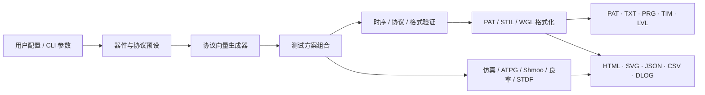
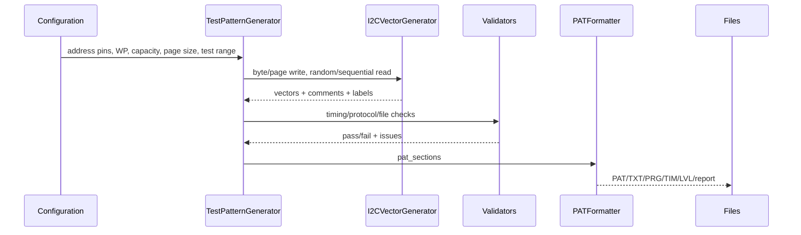
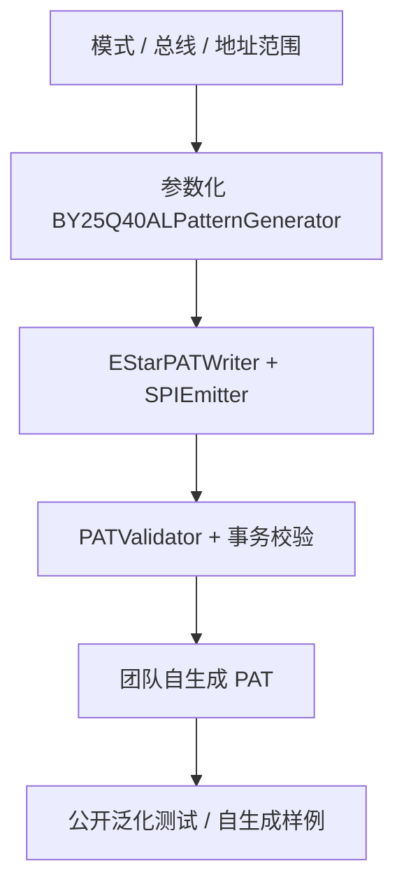
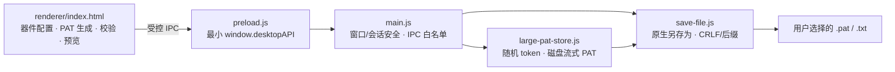

# 架构说明 / Architecture

项目有三套入口。根平台追求功能覆盖、分析闭环和器件扩展；复赛平台追求对指定竞赛 PAT 方言的精确约束与可回归交付；全国总决赛平台追求多类存储器、超大 PAT 和离线 Electron 桌面交付。三者共享“配置 → 生成 → 验证 → 格式化 → 导出”的思想，但不共享全部代码，也不应混用格式假设。

## 总体视图



生成器输出的是逐周期数字状态和标签；格式化器决定文件方言；验证器检查约束；分析模块消费向量或模拟数据。保持这四类职责分离，是后续从单文件架构拆分时最重要的边界。

## 根平台

### 入口与依赖

- `at24c02_pat_generator.py`：主入口、GUI、CLI 和大部分领域逻辑；
- `waveform_html.py`：交互式波形网页导出；
- `flowchart_template.py`：测试流程网页导出；
- `generate_samples.py`：固定 AT24C02 示例批量生成。

主程序使用 CustomTkinter 构建界面，同时保留部分 `tkinter` / `ttk` 原生控件用于文本、Canvas、表格和对话框。核心生成逻辑不依赖 GUI 事件循环，CLI 可以直接调用。

### 核心数据结构

I2C 主路径上的一条向量是以引脚名为键、状态字符为值的字典。当前 EStar 风格引脚顺序为：

```python
TEST_PINS = ["A0", "A1", "A2", "WP", "SCL", "SDA"]
```

一次测试生成通常返回三个等长序列：

```text
vectors   每周期的引脚状态
comments  对应周期的说明或测量标记
labels    start/end/测试段标签
```

`pat_sections` 再把它们包装为：

```text
(name, description, vectors, comments, labels)
```

格式化、预览、统计和导出都围绕这个结构工作。修改生成器时，必须维护三个序列的对齐关系。

### 分层职责

| 层 | 代表类 / 模块 | 职责 |
|---|---|---|
| 器件与协议 | `I2CVectorGenerator`, `SPIVectorGenerator`, `MicrowireVectorGenerator` | START/STOP、位/字节、命令、地址、ACK、读写事务 |
| 测试方案 | `TestPatternGenerator` | 功能测试、March、扫描、保持、异常、耐久和 IDDQ 等测试段 |
| 格式化 | `PATFormatter`, `STILFormatter`, `WGLFormatter` | 将统一向量变为具体文件语法 |
| 静态验证 | `I2CTimingChecker`, `VectorProtocolValidator`, `EStarValidator` | 时序、协议状态机、文件结构和跨文件引用检查 |
| 执行与分析 | `PatternSimulator`, `FaultCoverageSimulator`, `MemoryATPG` | 软件事务模拟、故障注入与覆盖证明 |
| 测试工程 | `TestFlowEngine`, `PinMapManager`, `MultiSiteGenerator`, `TestPhaseManager` | 流程、通道、Site 和阶段配置 |
| 数据与优化 | `DatalogGenerator`, `STDFWriter`, `STDFReader`, `YieldPredictor`, `GuardBandEngine`, `CorrelationAnalyzer` | 合成数据、标准记录、统计和限值分析 |
| 可视化 | GUI、`waveform_html.py`, `flowchart_template.py` | PAT/TXT、波形、流程、Shmoo、Wafer Map 和报告 |

### I2C 生成链路



以写后读为例，测试方案层负责选择地址、数据和预期值；协议层负责器件地址、字地址、ACK Polling、Repeated START 和逐 bit 相位；格式层负责 `HEAD`、`@@PATTERN_DEFINE`、`start:` / `end:` 等语法。

### GUI 与批处理的关系

GUI 提供 16 个分析/预览页，包含 PAT、TXT、波形、说明、流程、统计、模拟器、Shmoo、流程编排、良率、ATPG、经济学、迁移、Datalog、Wafer Map 和温度角。它还维护部分交互状态，如最近目录、主题、语言和项目快照。

批处理入口只暴露生成和主要格式导出，不等同于 GUI 全功能自动化。增加 CLI 能力时应显式扩展参数和测试，而不是依赖 GUI 成员变量。

## 复赛 BY25Q40AL 平台

### 为什么独立实现

复赛阶段需要对指定芯片、总线模式、地址边界和 PAT 输出进行更严格的参数约束。为减少通用平台改动对竞赛专用生成链路造成的意外变化，团队采用独立入口；公开仓库只保留独立创作的生成器、验证器、测试和自生成样例：

```text
regional-final/by25q40al/
├─ by25q40al_pat_generator.py
├─ tests/                      自生成、协议、边界和打包回归
├─ README.md                   公开版使用与合规边界
└─ BY25Q40AL_PAT_Generator.spec
```

比赛现场的内部版本曾在获授权环境运行 30 项回归。赛方黄金 PAT、FUNC 模板、培训资料和私有规范属于第三方赛事资产，不进入公开目录；公开 CI 不能被描述为对这些私有语料的逐字节认证。详见[知识产权与公开边界](legal-and-ip.md)。

### 公开生成路径



- 固定和自定义地址范围都由公开参数化引擎生成；
- 页写范围按 256 Byte 对齐，读比较范围不扩展；
- `PATValidator` 与事务验证共同阻止状态字符、块结构和总线语义回退；
- 第三方赛事资料不是该流水线的输入；本项目不接收、不定位、不自动读取或提供相关资产/哈希/复制/对比工具。

## 全国总决赛 Electron 平台

决赛工程位于 `national-final/`，采用主进程、受限 preload 和纯前端 renderer 三层结构：



关键边界：

- renderer 设置 `nodeIntegration: false`、`contextIsolation: true`、`sandbox: true`，不能直接调用 `fs` 或执行系统命令；
- preload 只暴露保存和大 PAT 流式操作，不暴露通用 IPC；
- 主进程验证 sender URL、请求字段白名单、类型、长度、token 和读写范围；
- CSP 与 session 层共同拒绝外部网络、下载、新窗口、WebView、外部导航和权限请求；
- 普通 PAT 在 renderer 中编辑；大 PAT 从生成开始写入临时文件，使用 5,000 行窗口预览，保存时不把全文复制回 renderer；
- 应用退出、取消、替换失败和 token 废弃都会触发临时文件清理；
- `package-lock.json`、`.nvmrc`、Electron builder 配置和第三方许可共同形成公开构建输入。

业务页面同时包含 SPI Flash、SRAM、I²C EEPROM、SPI EEPROM 的固定与自定义生成路径。完整当前实现位于公开 renderer；团队内部历史兼容快照被 Git 明确排除。内部参考 PAT、厂商文档和其他受限资料不是 CI、构建或公开复现输入。

## 验证层级

项目中的“通过”需要说明是哪一层：

1. **导入 / 语法层**：Python 文件可导入，PAT 行可解析；
2. **结构层**：HEAD、PATTERN 块、标签和跨文件引用成对；
3. **协议层**：START/STOP、命令、地址、比较相位、WIP/WEL 等事务符合实现契约；
4. **回归层**：自生成快照或语义测试未变化；合法持有者自行进行的私有离线核验不属于公开复现层；
5. **设备层**：目标 ATE 成功导入并执行；
6. **硅验证层**：在真实 DUT、负载板和工况上验证限值与覆盖。

仓库自动测试主要覆盖前四层。设备层和硅验证层必须由拥有目标硬件、授权资料和安全操作条件的使用者完成。

## 当前架构债务

根主程序为竞赛迭代形成的单文件架构，优点是部署直接、现场替换简单，代价包括：

- GUI 状态与领域逻辑之间仍有较多直接调用；
- 部分测试分类在 GUI、CLI、示例脚本中的计数口径不同；
- 设备方言、器件参数和展示逻辑尚未完全数据驱动；
- 大文件增加代码审查、单元测试和多人并行修改成本。

后续拆分必须以回归测试和可比较输出为前提，不为“目录更漂亮”改变向量语义。计划见[路线图](roadmap.md)。
