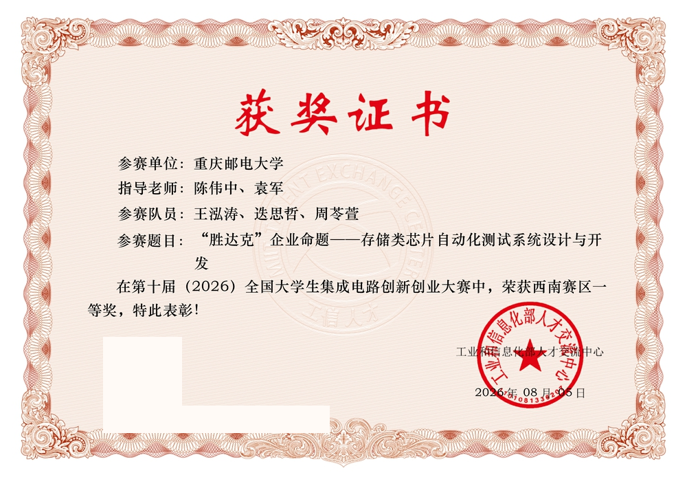
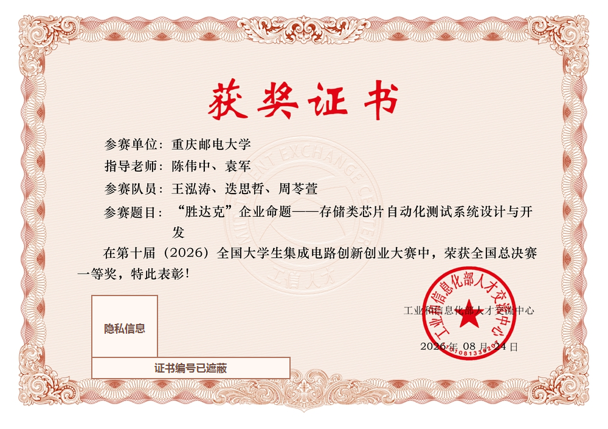
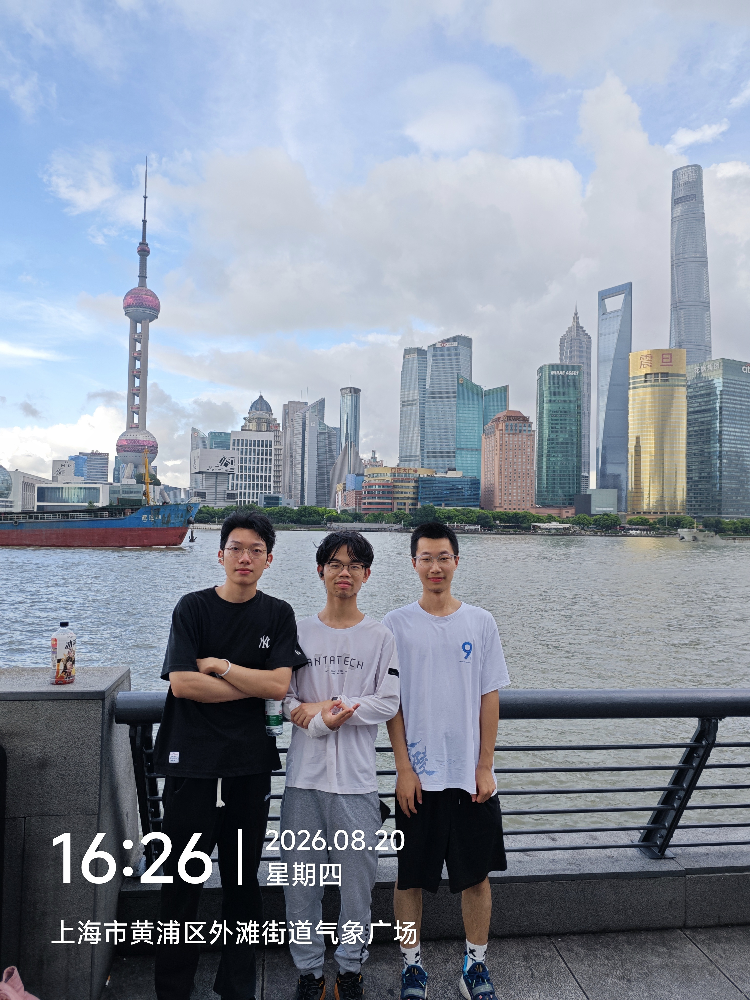
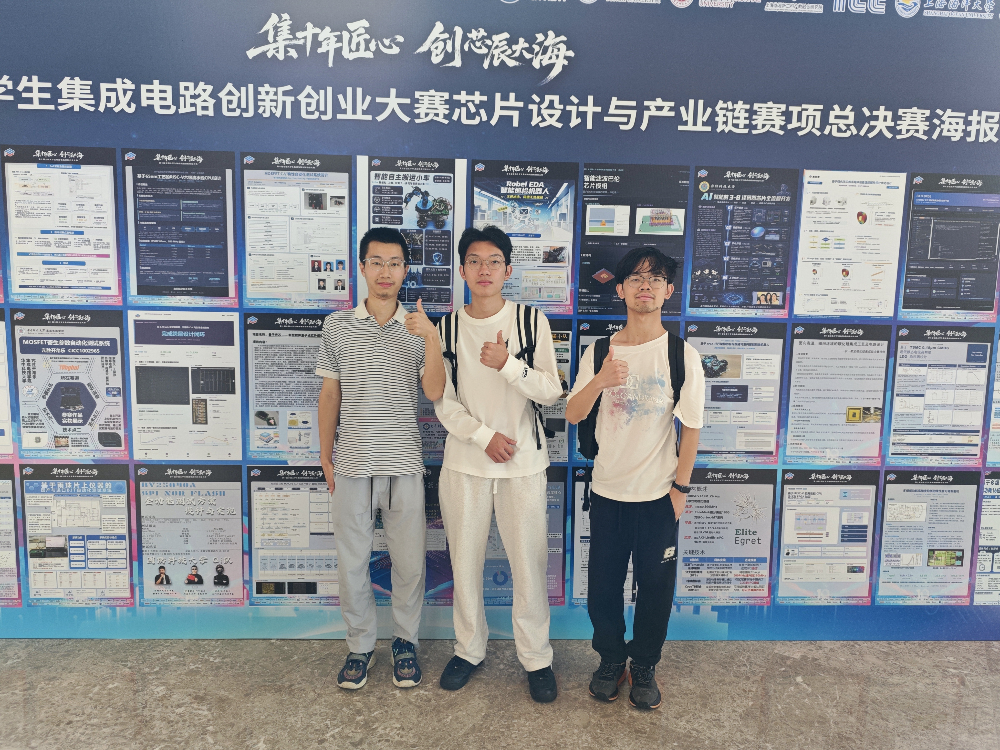
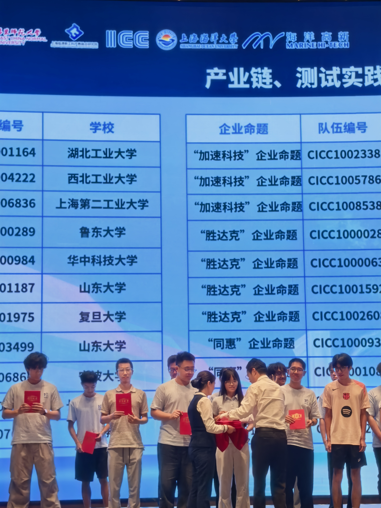
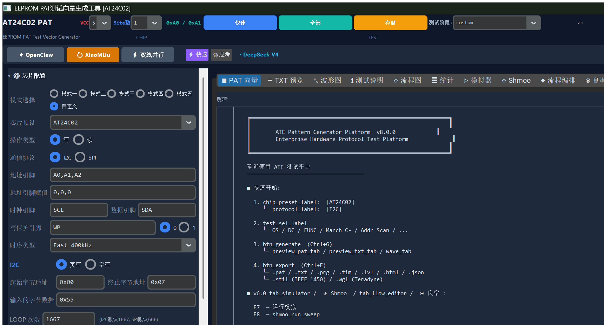
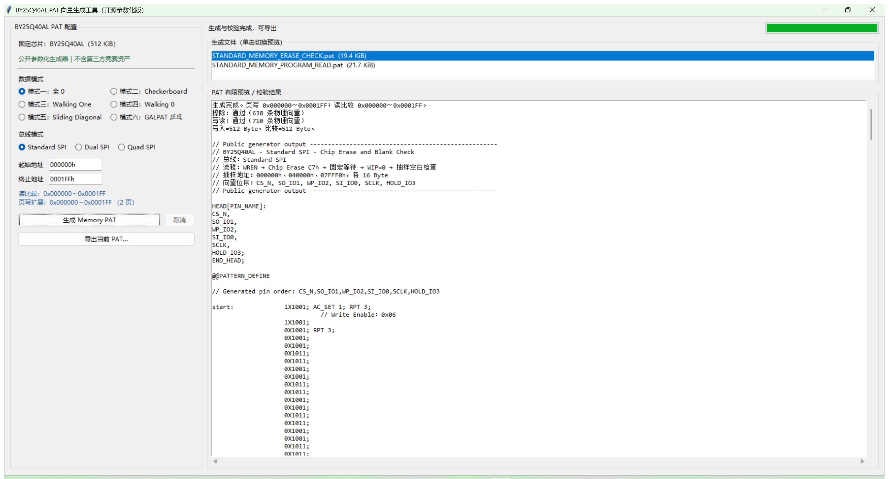
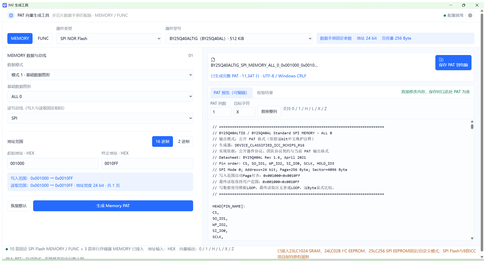

# 竞赛历程 / Competition Story

## 项目定位

本项目为全国大学生集成电路创新创业大赛[第十届“胜达克”企业命题](https://univ.ciciec.com/nd.jsp?id=1024)开发，主题是存储类芯片自动化测试系统与 PAT 测试向量软件。

团队在**西南赛区获得一等奖**，并在**全国总决赛获得一等奖（全国一等奖）**。这里的“一等奖”是奖项等级，不是名次口径。大赛官网已发布[成都工业学院赛点获奖名单公示](https://univ.ciciec.com/nd.jsp?fromMid=3&groupId=2&id=1083)；两份证书分别是西南赛区和全国总决赛奖项口径的直接材料。

两份证书均已获授权公开。展示版本保留团队成员、指导教师和奖项信息，遮蔽二维码与证书编号，以减少无关标识信息的传播。

| 西南赛区一等奖证书 | 全国总决赛一等奖证书 |
|---|---|
|  |  |

> 图片仅用于记录团队获得西南赛区一等奖和全国总决赛一等奖的赛事经历；上方大赛官网获奖名单提供公开赛事记录。展示不表示主办方或命题企业为本开源仓库背书。

> **English:** This project was developed for the “ShengDaKe” enterprise challenge of China’s National College Student Integrated Circuit Innovation and Entrepreneurship Competition. The team received First Prize in the Southwest regional stage and First Prize in the National Finals. “First Prize” is an award tier, not an overall ranking. The national-finals PAT platform v1.0.9 is open source.

## 全国总决赛一等奖与参赛纪念

2026 年 8 月，团队赴上海参加第十届大赛全国总决赛，并获得全国总决赛一等奖。以下三张照片分别记录上海参赛行程、总决赛项目海报展示和一等奖颁奖现场。团队成员已同意公开本人真实人物形象；公开副本已移除 EXIF/GPS 等隐藏元数据。颁奖现场含其他参赛者，但本文不标注或识别无关人员。







> 照片仅用于赛事经历记录；人物肖像已获团队成员同意公开。赛事背景、其他参赛项目海报、标识和现场布置不属于本项目 Apache-2.0 许可范围，展示不表示主办方或命题企业为本仓库背书。

## 三个阶段，三种工程重点

### 初赛：AT24C02 完整测试平台

初赛阶段的目标不是只生成一份能展示的 PAT，而是搭建从配置到交付的完整软件闭环：

- 以 AT24C02 I2C EEPROM 为核心 DUT；
- 建立 START、STOP、Repeated START、读写字节、ACK/NACK 和 ACK Polling 等逐周期协议原语；
- 组合 OS、DC、功能、March、地址扫描、保持、异常、耐久和 IDDQ 等测试逻辑；
- 输出 PAT、TXT、PRG、TIM、LVL、HTML、JSON、CSV 等工程文件；
- 提供波形、流程、统计、模拟、ATPG、Shmoo、良率和测试数据分析界面；
- 保留 GUI、CLI、示例输出和 Windows 打包路径。

公开入口：

- [`at24c02_pat_generator.py`](../at24c02_pat_generator.py)
- [`generate_samples.py`](../generate_samples.py)
- [`output/`](../output/)



### 复赛：BY25Q40AL 竞赛优化 PAT 平台

复赛阶段面对的主要问题从“功能覆盖”转为指定芯片和现场 PAT 约束下的稳定生成。因此单独开发了 BY25Q40AL 工具，公开部分重点包括：

- Standard / Dual / Quad SPI 三种总线；
- 六种 Memory 数据与算法模式；
- 固定引脚 HEAD、四向量时钟、比较相位、RPT / LOOP 和输出文件名；
- 页写范围扩展与读比较范围保持；
- 团队独立实现的参数化生成器、PAT 校验器和自生成样例；
- 语法、事务、边界、GUI 文案和打包配置的公开泛化回归；
- 适合比赛现场的独立 GUI、CLI 和单文件 EXE 交付流程。

公开入口：

- [`regional-final/by25q40al/`](../regional-final/by25q40al/)
- [`regional-final/by25q40al/README.md`](../regional-final/by25q40al/README.md)
- [`regional-final/by25q40al/tests/`](../regional-final/by25q40al/tests/)



比赛现场内部版本曾在获授权环境运行 30 项回归；公开版因合规不附赛方黄金 PAT、FUNC 参考模板或其他第三方赛事资料，因此公开 CI 不代表私有参考语料的逐字节验证。这套工具的“优化”主要指对赛题输入、指定芯片和现场交付流程的针对性约束，不代表对所有 SPI Flash 或所有 ATE 的普遍最优。

### 全国总决赛：全国一等奖，软件 v1.0.9 已开源

决赛阶段形成了独立的多器件 PAT 生成软件平台，当前公开内容包括：

- Windows 10/11 x64 离线 Electron 桌面应用；
- 固定/自定义 SPI Flash、23LC1024 SRAM、24LC02B I²C EEPROM、25LC256 SPI EEPROM；
- MEMORY / FUNC、SPI / SDI / SQI、数据模式、地址范围和自定义事务；
- 普通 PAT 编辑、校验、整列替换和原生保存；
- 超大 PAT 的协作式生成、取消、磁盘流式存储与分段预览；
- 19 项 Node 单元/完整性测试和 31 项 Electron 交互/生成回归；
- 锁定依赖、第三方许可、Windows 构建脚本和带 SHA-256 的 Release。

公开入口：

- [`national-final/`](../national-final/)
- [`national-final/README.md`](../national-final/README.md)
- [`national-final-v1.0.9` Release](https://github.com/Xiaomiju-x/memory-ate-pat-platform/releases/tag/national-final-v1.0.9)



软件基线已发布，但比赛成绩尚未公布，EXE 也未使用商业代码签名。公开测试覆盖软件结构与协议契约，不替代目标 ATE 导入、真实器件、负载板、电平时序和设备安全签核。内部参考 PAT、厂商资料和其他无公开再分发权的内容不随仓库发布。

## 代码与算法职责

这是团队参赛成果，奖项属于整个参赛团队。仓库维护者在软件方向的主要职责为：

- 负责核心代码与算法实现；
- 搭建初赛 AT24C02 完整测试平台；
- 负责复赛 BY25Q40AL 竞赛约束下的 PAT 向量软件开发与优化；
- 持续负责决赛 PAT 向量生成测试软件的代码和算法工作。

公开叙事刻意区分“团队获奖”和“个人软件职责”，既不抹去协作，也不把非个人完成的工作归于个人。

## 从竞赛交付到开源项目

竞赛现场往往优先考虑可执行文件、固定命名、参考格式一致性和快速迭代；公共仓库还需要补齐另一组质量属性：

| 竞赛交付关注点 | 开源化补充 |
|---|---|
| 能按赛题输入生成 | 给出可复现 CLI、配置和最小示例 |
| 能在现场电脑运行 | 声明 Python / Windows 版本和依赖 |
| 与授权参考资料核验 | 由合法持有者在授权范围自行离线完成；不属于公开复现步骤 |
| EXE 可以交付 | 同时提供源码、构建脚本、测试状态和校验值 |
| 答辩展示完整 | 清楚标注模拟数据、模板和真机验证边界 |
| 团队内部资料齐全 | 移除隐私、密钥和未授权第三方材料 |

这也是本次开源整理的核心：让别人能理解、运行、验证和继续改进，而不仅是下载一个黑盒文件。

## 奖项与材料使用说明

- [第十届大赛章程](https://univ.ciciec.com/col.jsp?id=123)明确区分团队独立作品与企业资料，并要求赛事资源未经授权不得传播；本仓库据此只发布团队拥有权利的部分。
- 赛题归属与项目背景可在[官方“胜达克”企业命题页](https://univ.ciciec.com/nd.jsp?id=1024)核对。
- 证书图片用于证明本项目对应的西南赛区和全国总决赛奖项；转载时请保留上下文，不用于暗示主办方为本开源仓库背书。
- 比赛名称、企业名称、芯片型号和设备名称归其各自权利人所有，仅用于说明兼容目标和项目背景。
- 仓库不是主办方、命题企业、芯片厂商或 ATE 厂商的官方发布渠道。
- 如公开材料中仍有应脱敏内容，请按 [SECURITY.md](../SECURITY.md) 私下报告，不要在公开 Issue 中扩散。

## 如何引用

在课程报告、论文、比赛复现或衍生项目中，可以引用：

```text
Memory ATE PAT Platform — 存储芯片自动测试与竞赛 PAT 向量平台，
全国大学生集成电路创新创业大赛“胜达克”企业命题参赛项目，
https://github.com/Xiaomiju-x/memory-ate-pat-platform
```

请同时记录所使用的 release 或 commit，因为测试范围、输出方言和器件预设会继续演进。
