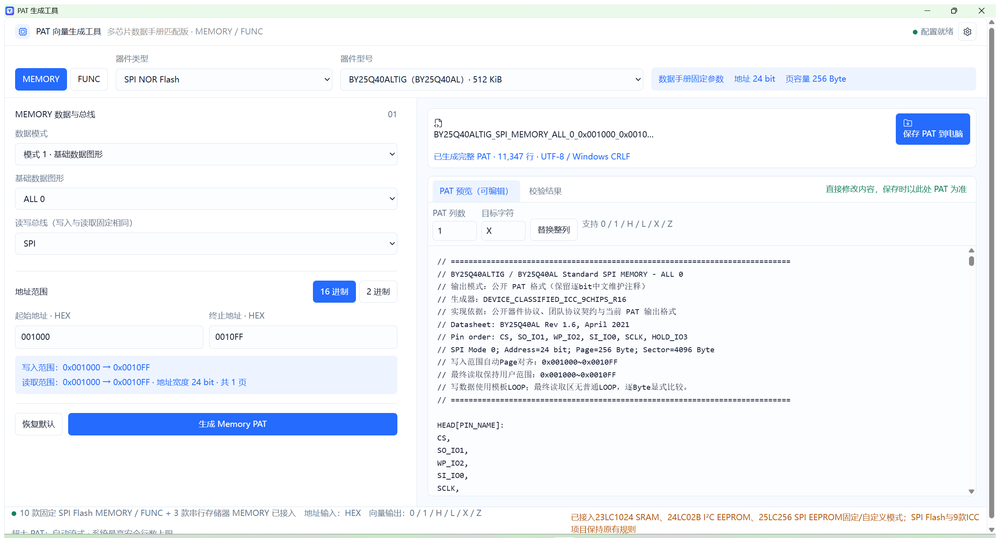

# PAT生成工具 — 全国总决赛便携版

本目录是全国总决赛阶段 PAT 向量生成软件的完整开源工程。它将团队编写的页面生成器封装为 Windows 10/11 x64 离线桌面应用，使用 Electron + electron-builder；最终用户不需要安装 Python、Node.js、Electron、浏览器或额外运行库。

当前公开的是可运行、可测试、可复现构建的 `1.0.9` 软件基线。全国总决赛已经完赛，成绩预计于 **2026 年 8 月 21 日**公布；当前不提前声明任何总决赛奖项或名次，也不声称主办方认证。

## 直接使用

最终便携版：[`National_Final_PAT_Generator_v1.0.9_Windows_x64.exe`](https://github.com/Xiaomiju-x/memory-ate-pat-platform/releases/download/national-final-v1.0.9/National_Final_PAT_Generator_v1.0.9_Windows_x64.exe)

发布说明、SHA-256 和源码 tag：[`national-final-v1.0.9`](https://github.com/Xiaomiju-x/memory-ate-pat-platform/releases/tag/national-final-v1.0.9)

把这一个 EXE 复制到桌面、U 盘或任意普通文件夹后双击即可。它没有安装向导，不要求管理员权限，不创建服务、卸载项或注册表项。首次启动会由 portable 外壳自动解包到用户临时目录，这是自动过程，不需要用户手工解压。

- 当前版本：`1.0.9`
- 目标平台：Windows 10/11 x64
- 默认窗口：1440×900，最小 1100×700，可最大化

## 软件界面

下图为公开便携版实际运行界面：选择 BY25Q40AL、Standard SPI、ALL 0 数据图形后，软件已生成并加载一份 `11,347` 行的 MEMORY PAT，可继续编辑、校验或保存。



## 保留的页面能力

- 中文界面以及 MEMORY / FUNC 页面切换；
- 器件类型与器件型号联动；
- 固定 SPI Flash 与自定义 SPI Flash 的原有 PAT 生成逻辑；
- 固定 23LC1024 SRAM 的 SPI / SDI / SQI、模式 1 / 模式 2 与受限范围 GALPAT，以及可配置的自定义 SRAM TX 流程；
- 固定 24LC02B EEPROM 与自定义 I2C EEPROM 的页写、当前地址读、随机读和顺序读；
- 固定 25LC256 与自定义 SPI EEPROM：EEPROM 协议 IIC/SPI 二级筛选、WREN/WRITE/RDSR/READ、物理页安全拆分及可编辑 TX；
- SPI / SDI / SQI、数据模式、地址和自定义 TX 配置；
- 自定义 SRAM / I²C EEPROM / SPI EEPROM 的结构说明 TXT，以及自定义 TX 在 PAT 预览中的快速定位；
- 普通 PAT 预览直接编辑、六列字符批量替换和校验结果；超大 PAT 使用磁盘流式生成与分段安全预览；
- PAT 保存；自定义 SPI Flash 的结构说明 TXT 单独保存；
- 页面脱离 Electron 后仍保留原 `showSaveFilePicker` / 浏览器下载回退。

PAT 主体生成算法没有重写或简化。当前完整业务源码直接位于 `renderer/index.html`；`1.0.1` 加入协作式生成和窗口预览，`1.0.2` 为超过内存阈值的结果加入磁盘流式通道，`1.0.3–1.0.7` 持续修正固定 SPI Flash 的 SDI VOL、Dual/Quad 指令和 FUNC WIP 轮询，`1.0.5` 增量补入 SRAM、I²C EEPROM 和 TX 定位，`1.0.8` 接入 SPI EEPROM，`1.0.9` 专项修复固定 SRAM / EEPROM 在大行数下的内存合并和同步写模板卡顿。团队内部历史兼容快照不随仓库分发；公开测试直接验证当前源码的协议和安全契约，也不附带内部参考 PAT、厂商资料或其文件名/哈希。详见 [SOURCE_INTEGRITY.md](SOURCE_INTEGRITY.md) 和仓库的[知识产权与公开边界](../docs/legal-and-ip.md)。

## 固定 SPI Flash 协议矩阵（1.0.4）

本轮逐项核对公开数据手册的指令表和时序图，并在授权离线环境完成内部兼容性复核。内部参考资料不是公开构建或测试输入；公开版以源码中的协议契约和团队测试保护下列三类固定型号行为：

- A 类 — BY25Q40AL/BY25Q40ALTIG、BY25Q16BL、BY25Q80AL：Dual MEMORY/FUNC 使用 `A2h` 双线数据写入与 `3Bh` Dual Output Read；命令和地址保持单线，`A2h` 数据阶段为双线，`3Bh` 为单线命令/地址、8 Dummy、双线数据。
- B 类 — GD25LQ40E、W25Q64JVSSIQ、BY25Q16ESOIG、BY25Q80ES、GD25Q40CTIG、W25Q40CLSNIG：Dual MEMORY/FUNC 使用 `02h` 全单线 Page Program 与 `3Bh` Dual Output Read，不再把 `02h` 数据阶段误作双线，也不生成 `A2h`。
- MX 类 — MX25U4033E/MX25U4033EM：Dual 使用 `02h` 全单线写入与 `BBh` 2READ；Quad/SQI 使用非易失性状态寄存器 bit6 设置 QE、`38h` 4PP 和 `EBh` 4READ。SPI/SDI 生成前恢复 QE=0；SQI 生成后保留 QE=1，并明确标注掉电后 QE 仍保持 1。

W25Q64JVSSIQ 已加入固定型号 profile，开放已有协议契约和公开回归覆盖的 SPI 与 SDI MEMORY/FUNC；缺少足够公开验证依据的 SQI FUNC 不启用。`1.0.7` 后，七款无 A2h 的固定器件在 SDI VOL 中都按各自 `02h` Page Program 规则由 SI/IO0 单线写入数据；三款 A2h 器件仍保持双线写数据，其他 VOH/ICC 与未覆盖型号行为不变。

## 1.0.5 补充功能

- 23LC1024：固定 SPI / SDI / SQI MEMORY，模式 1、模式 2，以及最多 256 Byte 的 GALPAT；
- 自定义 SRAM：WRITE / READ / EDIO / EQIO / RSTIO / WRMR / RDMR 可编排 TX，生成后可按 TX 快速跳转；
- 24LC02B：Page Write、Current Address Read、Random Read、Sequential Read，并保留 ACK/NACK、页边界拆分和写等待；
- 自定义 EEPROM：可配置 I2C 控制字节、8/16/24-bit 字地址、页大小、写等待和读写事务，并可导出结构说明 TXT；
- 所有新增路径复用当前可取消、协作式、磁盘流式和分段预览机制，超大结果不会退回旧的逐行 DOM 渲染；
- 25LC256 仍是未接入的界面选项，不会伪生成缺少协议依据的 PAT。

## 1.0.6 显式生成与预览保持

- 只有用户点击“生成 Memory PAT”或“生成 FUNC PAT”时，才会运行对应生成器并用新结果替换 PAT 预览；
- 修改器件、总线、模式、地址、EEPROM 参数、TX/QTX 或 FUNC 类别/参数时，只更新配置控件和摘要，不会在后台自动生成；
- MEMORY/FUNC 视图切换会保留最后一次成功生成的 PAT、文件名、校验、结构说明和超大文件流式 token，直到再次显式生成或用户主动重置；
- 普通 PAT 的手工编辑、整列替换和导出仍保留；手工编辑后立即切换预览页签也会先提交当前文本，避免被旧快照覆盖；
- 超大流式预览的迟到分段读取不会覆盖校验/结构说明页；自定义器件的结构说明 TXT 与最后生成快照绑定，不因随后切换器件而失效；
- 该版本没有修改 MEMORY/FUNC PAT builder。公开回归覆盖固定/自定义 Flash、FUNC、SRAM 与 EEPROM 的代表配置，并核对显式生成、协议序列、文件名、行数和关键界面状态。

## 1.0.7 SDI VOL 与 FUNC WIP 轮询

- BY25Q80ES、W25Q64JVSSIQ 的 SDI VOL 已按器件协议和内部兼容性复核修正：`02h` 命令、24-bit 地址和 `00h` 数据全部由 SI/IO0 单线发送，数据为 8 个 SPI 时钟；随后仍以 `3Bh` 单线命令/地址、8 Dummy、IO1/IO0 双线数据回读，并以 `end: 0L1L11;` 保持 Low；
- 七款 BY25Q16ESOIG、BY25Q80ES、GD25LQ40E、GD25Q40CTIG、W25Q40CLSNIG、MX25U4033EM、W25Q64JVSSIQ 的 SDI FUNC 写读保持 `02h` 单线写数据；其中六款以 `3Bh` 回读，MX25U4033EM 仍按 `BBh` 2READ 回读；
- 三款 BY25Q16BL、BY25Q40ALTIG、BY25Q80AL 的 SDI FUNC 写读保持 `A2h` 命令/地址单线、数据双线写入，再以 `3Bh` 双线回读；
- FUNC 写数据与读回数据仍逐 Byte、逐时钟显式展开，数据事务内不使用普通 `LOOP`；每次 Sector Erase 和 Page Program 后紧邻 `05h` 状态事务，并以 `LOOP MATCH` / `LOOP END` 轮询 WIP=0；
- FUNC 状态轮询的每次 SR1 读取按 8 bit × 4 vectors 完整输出，`LOOP MATCH` 位于 05h 命令之后，`LOOP END` 闭合在 S0/WIP=0 周期；轮询次数沿用各固定型号 profile，不改 MEMORY、QE、VOH、ICC 或自定义器件路径。

## 1.0.8 SPI EEPROM 增量

- EEPROM 类型新增 IIC / SPI 二级筛选；首次进入 EEPROM 仍默认 IIC，保持 1.0.7 的一步进入 24LC02B 行为，用户可显式切换 SPI；
- 启用固定 25LC256：16-bit 线上地址（A15 为 DC，本工具规范化驱动 0）、64 Byte 物理页、32 KB 容量、`06h WREN → 02h WRITE → 05h LOOP MATCH 2000 → 03h READ`，READ 无 Dummy、绝不发送 NOR Flash 的 `20h` Sector Erase；
- 新增自定义 SPI EEPROM TX 编辑器，默认 WREN / WRITE / RDSR / READ，可分别选择 SPI / SDI / SQI 写读总线并导出结构说明 TXT；
- 固定与自定义 WRITE 均按真实物理页切片。跨页时每页独立执行 WREN→WRITE→RDSR；首尾部分页只写用户范围内的实际 Byte，避免页内回卷和“未写却读回比较”；
- 新功能接入现有显式按钮、协作式生成、取消、窗口预览和磁盘流式通道；候选 HTML 中与 1.0.7 冲突的自动刷新、旧 FUNC WIP、远程 CDN 和同步大 DOM 实现均未带入；
- 公开回归覆盖 SPI EEPROM 增量前后的代表功能，核对 PAT 协议序列、文件名、行数、团队自生成 SHA-256 与关键 UI 状态。

## 1.0.9 固定 SRAM / EEPROM 大文件修复

- 固定 23LC1024、24LC02B、25LC256 使用独立的 `100,000` 行内存/磁盘切换点；预计超过该值时从第一行起直接写入流式临时文件，避免先在 renderer 中堆积后迁移或一次性合并全文；
- 全局最高行数仍为 JavaScript 最大安全整数，`100,000` 只决定固定串行存储器的存储路径，不是生成上限；Flash 与自定义器件原有 `2,000,000` 行切换策略保持不变；
- 23LC1024 遇到奇数长度 Checkerboard、非 8 整倍 Walking/Sliding 等不可压缩写模板时，写向量改为每 64 Byte 协作式分片；输出 PAT 的每一行、LOOP、向量顺序和导出字节保持不变；
- 大文件仍采用 5,000 行只读窗口预览、可取消生成、流式校验和直接流式保存；取消候选任务会完整保留上一份成功 PAT。

## 50 万行与超大文件修复

- 逐 Byte 展开、Page/Phase 循环和全文件校验按批次让出主线程，生成时窗口可继续响应；
- 生成区显示实时阶段、已生成行数和进度，并可随时取消；取消后保留上一份已完成 PAT；
- 超过 12,000 行自动进入安全预览：每次只显示 5,000 行，可上一段、下一段或按行号跳转；
- 大文件预览不再为每一行创建 DOM 元素；完整 PAT 始终可以完整导出；
- Flash 与自定义器件预计不超过 2,000,000 行时使用分块内存累积；固定 SRAM / EEPROM 使用更保守的 100,000 行切换点；超过各自阈值时桌面版自动改为 UTF-8/CRLF 临时文件流式生成，正文不再复制进 renderer 内存；
- 若实际行数因自定义事务而超过预估，运行中的内存结果会在下一检查点自动、逐块迁移到流式临时文件，行序不变；
- 原固定 2,000,000 行拒绝限制已经取消，全局行计数改为 JavaScript 最大安全整数上限；实际可生成规模由器件合法地址范围、剩余磁盘空间和生成时间决定；
- 内存和磁盘流式两种大文件的“整列替换”都作用于完整 PAT，不只替换当前显示的 5,000 行；
- 流式 PAT 保存时直接复制已校验的临时文件，不经 IPC 复制整份正文；取消、替换失败或退出应用会清理对应临时文件；
- 用户主动点击 MEMORY/FUNC“生成 PAT”并完整成功后，会弹出中文成功提示，显示文件名和准确总行数；配置变化不再自动生成，取消或失败不会误弹。
- W25Q40CLSNIG、GD25Q40CTIG、BY25Q16ESOIG、BY25Q80ES、GD25LQ40E、W25Q64JVSSIQ 的 SDI VOL 按 `02h` 单线写 `00h`、`3Bh` 双线读 `00h`；MX25U4033E 按 `02h` 单线写 `00h`、`BBh` 双线回读，不再把 `02h` 数据阶段错误展开成双线时钟。
- 固定型号 Dual MEMORY/FUNC 已按 A 类 `A2h+3Bh`、B 类 `02h+3Bh`、MX 类 `02h+BBh` 分流；MX Quad/SQI 使用 `38h+EBh` 与非易失性 QE 流程。

安全预览中的大文件正文为只读，这是避免浏览器再次布局几十万个可编辑节点的必要保护；普通规模 PAT 仍保持原来的直接编辑能力。

## 原生保存保证

桌面版通过最小权限 `preload.js` IPC 调用主进程的 Windows 原生“另存为”对话框：

- PAT 只使用 `.pat` 类型筛选，错误或缺失后缀会被强制补为 `.pat`；
- TXT 只保存为 `.txt`；
- 两类文件均为 UTF-8（无 BOM）和 Windows CRLF；
- 普通 PAT 内容取自用户当前已编辑的预览；超大流式 PAT 从完整临时文件保存，不会只保存当前 5,000 行窗口；
- 取消对话框不会创建文件，也不会显示错误；
- 成功、取消和失败都会在原页面状态栏显示中文结果。

Renderer 没有 Node.js、`fs`、`child_process` 或任意系统命令权限。

## 开发与一键构建

构建机需要 Node.js 22.12+（仅构建时需要）。所有版本已锁定在 `package.json` 和 `package-lock.json`：

- Electron `43.4.0`
- electron-builder `26.15.3`
- @floating-ui/core `1.7.3`
- @floating-ui/dom `1.7.4`
- Lucide `1.17.0`

三项浏览器资源在构建时从上述锁定依赖逐字节归档到 `renderer/vendor`，便携包不依赖 `node_modules` 的 npm/pnpm 链接布局；完整性测试会核对归档资源与锁定依赖完全一致。

```bat
cd national-final
npm ci
npm test
npm run start
npm run portable
```

也可以直接双击 `build.bat`。它会依次执行锁定依赖安装、完整自动化测试和 portable 构建。构建脚本会清理中间文件，成功后 `dist` 中只保留一个 `PAT生成工具.exe`。

## 安全与离线设计

- `nodeIntegration: false`
- `contextIsolation: true`
- `sandbox: true`
- `devTools: false`
- 无应用菜单和浏览器地址栏
- 拒绝新窗口、WebView、外部导航、下载和所有权限请求
- CSP 禁止网络连接，所有 Floating UI / Lucide 资源从本地加载
- Floating UI / Lucide 的锁定版本资源直接封入 `app.asar`，离线启动不依赖构建机的包管理器目录结构
- Session 层再次阻断 HTTP/HTTPS，并关闭 Chromium 后台联网、组件更新、同步和 ping
- 主进程只接受受信任本地 renderer 发出的 `pat` / `txt` 保存请求，以及带随机 token、字段白名单和块大小限制的大 PAT 流式请求
- 未使用 `eval`，也不会执行用户输入的 PAT 文本

## 交付前验证结果

验证日期：2026-08-20；环境：Windows 11 x64。

| # | 验收项 | 结果与证据 |
|---|---|---|
| 1 | `npm run start` 正常、无 JS 错误 | 通过；实际启动 Electron，自动化加载页无 console error / page failure |
| 2 | MEMORY / FUNC 切换 | 通过；Electron DOM 冒烟测试 |
| 3 | 类型切换只显示对应型号 | 通过；SRAM / EEPROM / SPI_FLASH 三类逐项检查 |
| 4 | 固定与自定义器件生成 | 通过；SPI Flash、23LC1024/CUSTOM_SRAM、24LC02B/CUSTOM_EEPROM、25LC256/CUSTOM_SPI_EEPROM 均生成完整 PAT |
| 5 | 编辑预览后导出完全一致 | 通过；IPC 捕获内容逐字符比较，含结尾换行 |
| 6 | PAT 后缀、UTF-8、CRLF | 通过；后缀强制、字节与换行断言，无 BOM |
| 7 | TXT 单独保存 | 通过；自定义 Flash/SRAM/I²C EEPROM/SPI EEPROM 结构说明独立 IPC 与真实写盘测试 |
| 8 | 中文和空格路径 | 通过；在中文空格临时路径真实写入并回读 |
| 9 | 取消保存 | 通过；写盘调用次数为 0，页面显示“已取消导出” |
| 10 | portable 构建与无运行时启动 | 通过；`dist` 仅一个 EXE；在 PATH 中没有 Node/Electron 时直接运行并产生 sandbox renderer 进程 |
| 11 | 固定 Dual/Quad 指令矩阵 | 通过；A 类、B 类、MX 类逐型号覆盖 MEMORY/FUNC，并核对命令、地址、Dummy、数据宽度和 QE 状态序列 |
| 12 | SRAM / EEPROM 功能矩阵 | 通过；固定/自定义 SRAM 与 EEPROM、TX 定位、模式 2、GALPAT 及多线 SRAM 事务矩阵 |
| 13 | 七款 02h 器件的 SDI VOL | 通过；命令/地址/数据均为 SPI 单线写，六款用 `3Bh`、MX 用 `BBh` 双线回读；BY25Q80ES、W25Q64JVSSIQ 新增真实向量回归 |
| 14 | PAT 只由显式生成按钮更新 | 通过；配置、型号、视图和 FUNC 类别变化等待 850 ms 后，PAT 文本、文件名、行数与校验均保持不变 |
| 15 | FUNC 写读展开与 WIP 轮询 | 通过；10 款 SDI FUNC 逐型号核对，两个 256 Byte 样本验证写/读数据完全展开，擦除与编程后各有一个 05h `LOOP MATCH` / `LOOP END` |
| 16 | 公开回归与 SPI EEPROM | 通过；代表配置的协议、文件名、行数与自生成哈希稳定；25LC256/自定义 SPI EEPROM 解码验证 `06→02→05→03`、16-bit 地址、无 Dummy/20h 与跨页安全 |
| 17 | 固定 SRAM / EEPROM 大文件 | 通过；24LC02B、25LC256、23LC1024 全容量/最大模式直接流式，另覆盖 23LC1024 不可压缩写模板的持续心跳、完整哈希和取消回滚 |

大文件专项回归：BY25Q40ALTIG / SPI / MEMORY / `0x000000–0x002FFF` 实际生成 `521,237` 行；生成期间 UI 定时器持续推进，预览正文逐行 DOM 元素为 `0`，同时可跳转到末段并看到 `@@END_PATTERN_DEFINE`。

跨旧上限专项回归：同一器件从 `0x000000–0x00BFFF` 完整生成 `2,084,312` 行，自动进入真实磁盘流式路径；本机多轮回归中 UI heartbeat 持续推进。测试同时核对临时文件行数、无 BOM、末尾 CRLF、首末预览、完整流式整列替换、旧 token 清理，并验证更大任务取消后上一份 2,084,312 行结果保持不变；另有预估偏低配置验证运行中跨阈值迁移与取消清理。

25LC256 全容量专项：SPI / mode1 / ALL 0 / `0x0000–0x7FFF` 连续两次均生成 `1,497,257` 行，约 6.0 秒完成；10 ms UI heartbeat 持续 588/596 次，最大间隙低于 66 ms，预览 DOM 子元素为 0。全容量 mode2 创建流式 token 后约 170 ms 可取消，上一份结果保持且候选临时文件清空。自定义跨页 `0x003F–0x0040` 实际解码为 `06,02,05,06,02,05,03`，两个 WRITE 各 1 Byte，地址分别为 `003F`、`0040`。

固定串行存储器 1.0.9 专项：24LC02B mode2 全容量生成 `172,069` 行；25LC256 全容量生成 `1,497,257` 行；23LC1024 SPI 全容量生成 `5,636,515` 行。三者均从开始即进入流式路径、UI heartbeat 持续、预览最多 5,000 行且无逐行 DOM。另以 23LC1024 Checkerboard `0x000000–0x001A0A` 生成 `553,740` 行，写模板展开阶段持续 heartbeat，完整 PAT SHA-256 为 `FA970144C2795B18A4397F4C98B1E7ED76EF288D57AF89D7798EA1B8C1EEACEB`。

补充结果：

- Node 单元/完整性测试：19/19 通过；
- Electron 交互冒烟测试：31/31 通过；
- 当前源码的器件协议、显式生成、超大 PAT、安全边界与团队自生成哈希回归通过；
- `npm audit`（含开发依赖）：0 个已知漏洞；
- EXE 产品名、版本和 `asInvoker` 清单检查通过；
- 最终 EXE：`89,837,887` bytes，FileVersion/ProductVersion=`1.0.9`；
- 最终 EXE SHA-256：`889F7383B45BB90DF7A2E58D3286D24A790ABDD596AEAA33ED6FFE1525D502A0`；
- 包内 `app.asar` SHA-256：`D3FDF031AAD74DA379228BC683CCB0A4790C698B78327320791F082E5B48964C`；包内 renderer 与公开源码逐字节一致，`license=Apache-2.0`，并包含第三方许可文本。

## 已知限制

本次可验证“无需 Node/Electron”的本机净化 PATH 启动，但当前工作环境没有第二台干净 Windows 电脑或 Windows Sandbox，因此跨设备启动仍应在比赛提交电脑上做一次现场复核。

EXE 未做商业代码签名，Windows SmartScreen 可能显示“未知发布者”；这不影响离线运行。若需要消除该提示并建立发布者身份链，应使用团队代码签名证书重新构建和签名。

当前业务实现中明确未开放或存在边界风险的配置没有被桌面封装擅自扩展，完整清单见 [KNOWN_SOURCE_LIMITATIONS.md](KNOWN_SOURCE_LIMITATIONS.md)。在连接真实 ATE 前，请依据合法取得的目标设备文档、经授权的本地验收基线和 AdaptStar-E 实际语法完成签核；这些材料不属于本仓库的公开复现输入。

超大 PAT 安全预览只读，完整内容通过 PAT 导出或“整列替换”处理。固定 SRAM / EEPROM 使用 100,000 行、其他既有路径使用 2,000,000 行作为内存/磁盘流式切换点；两者都不是生成上限。极端全容量配置仍会受实际磁盘空间和生成时间约束。

## 图标替换

当前使用项目内的简单占位图标：`build/icon.ico`。替换时请提供至少 256×256、包含常用尺寸的 ICO 文件覆盖该路径，然后重新执行 `npm run portable`。

## 工程结构

```text
national-final/
├── package.json / package-lock.json
├── main.js / preload.js / save-file.js / large-pat-store.js
├── electron-builder.yml
├── build.bat
├── build/icon.ico
├── renderer/index.html / renderer/vendor/
├── scripts/build-portable.js / scripts/skip-dependency-rebuild.js
├── tests/
└── dist/PAT生成工具.exe       # 本地构建产物；发布到 GitHub Release，不进入 Git 历史
```

## 开源许可证

团队原创的决赛平台源码随仓库按 [Apache License 2.0](../LICENSE) 开源。Electron、electron-builder、Floating UI 和 Lucide 适用各自许可证，详见 [THIRD_PARTY_NOTICES.md](THIRD_PARTY_NOTICES.md)。芯片名称、赛事标识、数据手册和未随仓库分发的内部参考资料不因本项目开源而被重新许可。
